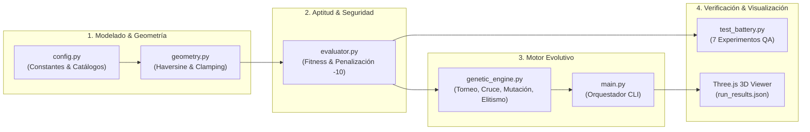

# AstroShield — Evolución de Constelación Satelital Inteligente
> Proyecto académico de optimización mediante Algoritmos Genéticos y visualización 3D interactiva en Three.js.  
> **Fundamentos de Inteligencia Artificial — Equipo de 5 Integrantes**

---



---

## 1. Descripción del Proyecto

**AstroShield** es un sistema de ingeniería computacional e inteligencia artificial diseñado para resolver el problema de despliegue espacial óptimo de una constelación de **8 satélites en órbita terrestre baja (LEO)**. El objetivo principal es maximizar la cobertura sobre **6 regiones terrestres prioritarias** para el monitoreo del cambio climático y la seguridad global, respetando de manera infranqueable **zonas de exclusión angular** impuestas por escombros orbitales (*space debris*) y activos satelitales preexistentes.

### Aspectos Clave de la Solución
* **Representación de Cromosomas Continuos (Real-Coded GA):** Vector continuo $\vec{X} \in \mathbb{R}^{16}$ con coordenadas $(\text{lat}_i, \text{lon}_i)$ que evita los *Hamming cliffs* binarios.
* **Geometría Esférica Numéricamente Estable:** Cálculo de distancia ortodrómica y separación angular mediante la formulación estabilizada de **Haversine** ($R_{\text{EARTH}} = 6371.0\text{ km}$) con acotamiento de dominio $a \in [0.0, 1.0]$.
* **Función de Aptitud Ponderada por Prioridades:** Asignación estratégica de pesos ($3.0$ Alta, $2.0$ Media, $1.0$ Normal; máximo $13.0\text{ puntos}$) combinada con una política de **penalización lineal severa ($\beta = 10.0\text{ pts}$ por infracción)** que actúa como barrera repulsiva sin quebrar la diversidad genética.
* **Monitor 3D Interactivo en Tiempo Real:** Visor WebGL desarrollado con **Three.js** que consume de forma asíncrona la telemetría generada, permitiendo alternar visualmente entre la configuración aleatoria inicial (Gen 0) y la solución óptima.

---

## 2. Estructura del Repositorio

El proyecto sigue una arquitectura desacoplada, modular y orientada a pruebas unitarias y de integración:

```text
AstroShield/
├── docs/
│   ├── 01_problem_definition.md   # Entregable 1: Formulación matemática rigurosa y genoma
│   ├── 04_results_analysis.md     # Entregable 4: Análisis empírico de resultados (7 preguntas)
│   └── README.md                  # Índice documental
├── src/
│   ├── __init__.py                # Inicializador de paquete Python
│   ├── config.py                  # Catálogos inmutables oficiales, dataclasses y constantes
│   ├── geometry.py                # Funciones ortodrómicas, ángulos centrales y exclusiones
│   ├── evaluator.py               # Función de aptitud multiobjetivo y diagnóstico de validez
│   └── genetic_engine.py          # Algoritmo genético continuo (AstroShieldGA)
├── tests/
│   ├── __init__.py                # Inicializador del módulo de pruebas
│   ├── test_config.py             # Pruebas unitarias de configuración e inmutabilidad
│   ├── test_geometry.py           # Pruebas unitarias trigonométricas y estabilidad numérica
│   ├── test_evaluator.py          # Pruebas unitarias de cálculo de fitness y restricciones
│   ├── test_genetic_engine.py     # Pruebas unitarias de operadores genéticos y elitismo
│   ├── test_main.py               # Pruebas unitarias de serialización a JSON
│   ├── test_battery.py            # Batería automatizada de los 7 experimentos de calidad (QA)
│   └── test_report.md             # Informe cuantitativo generado automáticamente
├── visualization/
│   ├── index.html                 # Interfaz HUD y dashboard de telemetría (Three.js)
│   ├── app.js                     # Motor gráfico WebGL, cúpulas esféricas y rotación orbital
│   └── data/
│       ├── .gitkeep               # Preservación de directorio
│       └── run_results.json       # Telemetría serializada consumida por el visor 3D
├── main.py                        # Orquestador CLI del Algoritmo Genético
└── README.md                      # Presentación general y manual técnico del proyecto
```

---

## 3. Requisitos y Configuración del Entorno

### Requisitos del Sistema
* **Python:** Versión **3.10 o superior** (3.11, 3.12, 3.13 totalmente compatibles).
* **Dependencias:** El núcleo computacional del proyecto hace uso exclusivo de la **Biblioteca Estándar de Python** (`dataclasses`, `typing`, `math`, `random`, `json`, `argparse`, `pathlib`, `unittest`), garantizando portabilidad sin necesidad de instalar dependencias externas pesadas ni entornos virtuales obligatorios.
* **Visualizador 3D:** Cualquier navegador web moderno (Google Chrome, Firefox, Safari, Microsoft Edge) con aceleración por hardware **WebGL** habilitada.

---

## 4. Guía de Ejecución Rápida

### 4.1 Ejecución del Motor Evolutivo y Exportación de Telemetría
Para ejecutar el Algoritmo Genético con la configuración estandarizada reproducible:

```powershell
python main.py --pop 100 --gen 150 --seed 42
```

#### Parámetros Disponibles por Línea de Comandos:
| Parámetro | Tipo | Valor por Defecto | Descripción |
| :--- | :---: | :---: | :--- |
| `--pop` | `int` | `100` | Tamaño de la población de constelaciones |
| `--gen` | `int` | `150` | Número máximo de generaciones a evolucionar |
| `--crossover` | `float` | `0.80` | Probabilidad de cruce uniforme a nivel de satélites ($80\%$) |
| `--mutation` | `float` | `0.15` | Probabilidad de mutación por satélite ($15\%$) |
| `--sigma` | `float` | `4.0` | Desviación estándar de perturbación gaussiana en grados sexagesimales |
| `--seed` | `int` | `None` | Semilla para garantizar reproducibilidad exacta |
| `--output` | `str` | `visualization/data/run_results.json` | Ruta del archivo de salida JSON |

### 4.2 Ejecución de la Batería Automatizada de Pruebas (QA)
Para ejecutar desatendidamente los **7 experimentos formales de validación** y regenerar el informe [tests/test_report.md](file:///c:/Users/marca/Documents/VScode/Fundamentos%20de%20IA/AstroShield/tests/test_report.md):

```powershell
python -m tests.test_battery
```

Para correr la suite completa de **26 pruebas unitarias**:
```powershell
python -m unittest discover -s tests -t .
```

### 4.3 Despliegue del Visor 3D Interactivo
Para visualizar la Tierra y la constelación en Three.js existen dos alternativas:

1. **Servidor Local Integrado de Python (Recomendado):**
   ```powershell
   python -m http.server 8000
   ```
   Abre en tu navegador la dirección:  
   👉 [http://localhost:8000/visualization/index.html](http://localhost:8000/visualization/index.html)

2. **Apertura Directa (Protocolo `file://`):**
   Abre [visualization/index.html](file:///c:/Users/marca/Documents/VScode/Fundamentos%20de%20IA/AstroShield/visualization/index.html) con doble clic. Si las directivas de seguridad CORS de tu navegador restringen el `fetch()` automático, la interfaz mostrará una tarjeta de respaldo donde puedes seleccionar el archivo [visualization/data/run_results.json](file:///c:/Users/marca/Documents/VScode/Fundamentos%20de%20IA/AstroShield/visualization/data/run_results.json) mediante el botón interactivo integrado.

---

## 5. Organización del Equipo de Trabajo (5 Integrantes)

Distribución de roles, módulos técnicos y asignación temática para la defensa oral del proyecto:

| Integrante | Rol Técnico | Componentes y Módulos a Cargo | Entregables Clave |
| :---: | :--- | :--- | :---: |
| **Integrante 1** | Arquitecto de Dominio & Geómetra | [src/config.py](file:///c:/Users/marca/Documents/VScode/Fundamentos%20de%20IA/AstroShield/src/config.py)<br>[src/geometry.py](file:///c:/Users/marca/Documents/VScode/Fundamentos%20de%20IA/AstroShield/src/geometry.py) | **Entregable 1**<br>[01_problem_definition.md](file:///c:/Users/marca/Documents/VScode/Fundamentos%20de%20IA/AstroShield/docs/01_problem_definition.md) |
| **Integrante 2** | Ingeniero de Evaluación & Optimización | [src/evaluator.py](file:///c:/Users/marca/Documents/VScode/Fundamentos%20de%20IA/AstroShield/src/evaluator.py)<br>[tests/test_evaluator.py](file:///c:/Users/marca/Documents/VScode/Fundamentos%20de%20IA/AstroShield/tests/test_evaluator.py) | Modelo de Aptitud y Penalizaciones |
| **Integrante 3** | Científico de Computación Evolutiva | [src/genetic_engine.py](file:///c:/Users/marca/Documents/VScode/Fundamentos%20de%20IA/AstroShield/src/genetic_engine.py)<br>[main.py](file:///c:/Users/marca/Documents/VScode/Fundamentos%20de%20IA/AstroShield/main.py) | **Entregable 2**<br>Motor Genético y Convergencia |
| **Integrante 4** | Ingeniero de Calidad (QA) & Datos | [tests/test_battery.py](file:///c:/Users/marca/Documents/VScode/Fundamentos%20de%20IA/AstroShield/tests/test_battery.py)<br>[docs/04_results_analysis.md](file:///c:/Users/marca/Documents/VScode/Fundamentos%20de%20IA/AstroShield/docs/04_results_analysis.md) | **Entregables 3 y 4**<br>Validación Empírica y Resiliencia |
| **Integrante 5** | Ingeniero Frontend & Gráficos WebGL | [visualization/index.html](file:///c:/Users/marca/Documents/VScode/Fundamentos%20de%20IA/AstroShield/visualization/index.html)<br>[visualization/app.js](file:///c:/Users/marca/Documents/VScode/Fundamentos%20de%20IA/AstroShield/visualization/app.js) | **Entregable 5**<br>Visor 3D y Telemetría HUD |

---

## 6. Declaración de Uso de Herramientas de Inteligencia Artificial

Dando riguroso cumplimiento a los criterios de transparencia ética y académica del **Entregable 6**:

### 6.1 Herramienta Utilizada
* **Entorno y Modelo:** Asistente de inteligencia artificial **Antigravity** integrado en **Visual Studio Code**.

### 6.2 Alcance del Uso de la IA
* **Generación Modular Guiada:** Creación asistida de la estructura base del repositorio, tipado estricto con `dataclasses` de Python, *scaffolding* de la escena 3D en Three.js y esqueletos de pruebas bajo especificaciones precisas provistas por el equipo.
* **Aceleración de Escritura Técnica:** Maquetación inicial de tablas comparativas y formateo de ecuaciones matemáticas en KaTeX/Markdown para los documentos de entrega.

### 6.3 Protocolo de Verificación Humana y Validación Realizada por el Equipo
El equipo de 5 integrantes asumió la responsabilidad técnica total de los artefactos generados mediante las siguientes tres fases de auditoría manual:

1. **Auditoría Matemática y Trigonométrica Independiente:**  
   Se verificó manualmente la formulación geodésica de Haversine y la transformación esférica a cartesiana ($\phi, \theta \rightarrow x, y, z$) en [src/geometry.py](file:///c:/Users/marca/Documents/VScode/Fundamentos%20de%20IA/AstroShield/src/geometry.py). Se implementó intencionalmente el acotamiento (*clamping*) $a \in [0.0, 1.0]$ para prevenir excepciones numéricas por desbordamiento de punto flotante IEEE 754 en puntos idénticos y coordenadas antípodas.
2. **Validación de la Jerarquía de Restricciones:**  
   Se diseñó y ejecutó la batería de pruebas [tests/test_battery.py](file:///c:/Users/marca/Documents/VScode/Fundamentos%20de%20IA/AstroShield/tests/test_battery.py) que audita los 24 pares de satélite-escombros y posiciones ocupadas, demostrando que ninguna solución que invada una zona de exclusión pueda sobrevivir con fitness positivo o superar a una configuración válida.
3. **Comprobación de la Fidelidad de Telemetría en el Visor 3D:**  
   Se comprobó que [visualization/app.js](file:///c:/Users/marca/Documents/VScode/Fundamentos%20de%20IA/AstroShield/visualization/app.js) no renderiza órbitas simuladas estáticas ni datos ficticios (*hardcoded*), sino que consume e interpreta dinámicamente las coordenadas geodésicas y métricas reales emitidas en [visualization/data/run_results.json](file:///c:/Users/marca/Documents/VScode/Fundamentos%20de%20IA/AstroShield/visualization/data/run_results.json).

