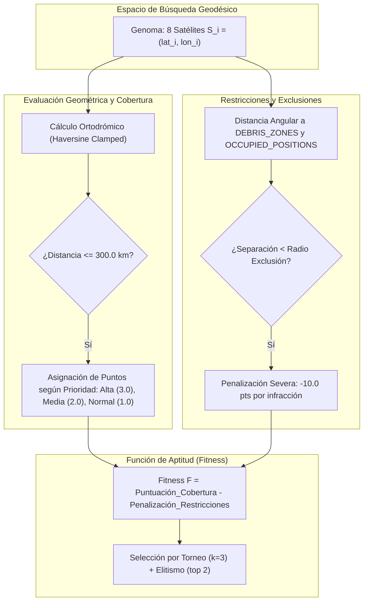
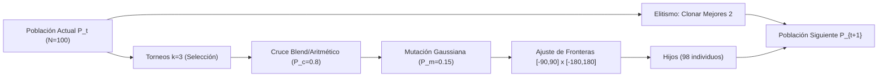

# AstroShield — Documento de Definición Formal del Problema
## Proyecto Académico de Optimización Evolutiva (Equipo de 5 Integrantes)

---

### Resumen Ejecutivo y Alcance del Documento

El proyecto **AstroShield** tiene como propósito diseñar, modelar y resolver mediante computación evolutiva el problema de despliegue espacial óptimo de una constelación de satélites de observación terrestre en órbita baja (LEO - *Low Earth Orbit*). El sistema debe maximizar la cobertura sobre regiones críticas terrestres con ponderación diferencial de prioridades, respetando estrictamente zonas de exclusión angular derivadas de escombros espaciales (*orbital space debris*) y órbitas ocupadas por activos preexistentes.

Este documento establece la formulación matemática rigurosa, la arquitectura del genoma, los modelos de cálculo esférico, la función de aptitud multiobjetivo con penalizaciones y la parametrización de la estrategia evolutiva para el **Entregable 1**.

---

## 1. Representación del Genoma (Cromosoma)

### 1.1 Codificación del Individuo

El problema de optimización busca determinar simultáneamente las coordenadas submástil o proyecciones subsatelitales de una constelación de $N_s = 8$ satélites independientes.

El fenotipo corresponde a la configuración de la constelación sobre la esfera terrestre $S^2$, mientras que el genotipo se modela formalmente como un vector continuo de dimensión $2 \times N_s = 16$:

$$\vec{X} = \left[ S_1, S_2, S_3, S_4, S_5, S_6, S_7, S_8 \right] \in \mathcal{D}^{8} \subset \mathbb{R}^{16}$$

Cada gen $S_i$ representa la posición espacial de un satélite individual definido como un par ordenado de coordenadas en grados decimales:

$$S_i = (\text{lat}_i, \, \text{lon}_i)$$

sujeto a los límites del dominio geográfico:

$$\text{lat}_i \in [-90.0^\circ, \, 90.0^\circ], \quad \text{lon}_i \in [-180.0^\circ, \, 180.0^\circ]$$

El espacio total de búsqueda $\mathcal{S}$ es un hipercubo acotado en 16 dimensiones:

$$\mathcal{S} = \prod_{i=1}^{8} \left( [-90.0, 90.0] \times [-180.0, 180.0] \right) \subset \mathbb{R}^{16}$$

### 1.2 Justificación Técnica: Algoritmo Genético de Valores Reales (RCGA) vs. Codificación Binaria

Para este problema se adopta un **Algoritmo Genético de Valores Reales** (*Real-Coded Genetic Algorithm* - RCGA) frente a la codificación binaria tradicional fundamentado en cuatro factores arquitectónicos:

1. **Eliminación del problema de los "Acantilados de Hamming" (*Hamming Cliffs*):**  
   En representaciones binarias estándar, dos estados adyacentes en el espacio continuo pueden diferir en todos sus bits (ejemplo: pasar de $0111_2$ a $1000_2$ requiere invertir 4 bits simultáneos). En coordenadas esféricas, esto genera barreras artificiales de mutación donde un paso infinitesimal en grados requeriría mutaciones múltiples coordinadas, degradando la eficiencia del algoritmo.
2. **Preservación de la Métrica en la Variedad $S^2$:**  
   Las coordenadas geográficas residen en una variedad diferencial continua. Los operadores genéticos reales (cruces aritméticos, combinaciones convexas y mutaciones gaussianas) operan de forma natural en espacios euclidianos y variedades continuas, permitiendo explorar vecindarios locales sin discontinuidades numéricas.
3. **Precisión Continua Arbitraria sin Inflación Genómica:**  
   Alcanzar una resolución submétrica con codificación binaria exigiría asignar al menos 24 bits por latitud y 25 bits por longitud ($49 \text{ bits/satélite} \times 8 \approx 392 \text{ bits}$ por cromosoma). El RCGA utiliza precisión de punto flotante de 64 bits nativa de la CPU (`float` en Python/C), eliminando el sobrecosto de decodificación y ensamblado de cadenas de bits.
4. **Eficiencia en Evaluación y Vectorización:**  
   Los cálculos trigonométricos directos sobre arrays de números reales evitan las conversiones *binario $\rightarrow$ entero $\rightarrow$ flotante reescalado*, optimizando el tiempo de reloj en el bucle generacional.

---

## 2. Criterio de Cobertura y Modelo Físico Simplificado

### 2.1 Modelo Geométrico y Distancia Ortodrómica

Se asume un modelo geodésico esférico de la Tierra con radio medio constante:

$$R_{\text{EARTH}} = 6371.0 \text{ km}$$

Dadas dos coordenadas $P_1 = (\phi_1, \lambda_1)$ y $P_2 = (\phi_2, \lambda_2)$ expresadas en radianes, la separación angular central $\Delta\sigma$ se calcula mediante la **fórmula numéricamente estabilizada de Haversine**:

$$\Delta\phi = \phi_2 - \phi_1, \quad \Delta\lambda = \lambda_2 - \lambda_1$$

$$a = \sin^2\left(\frac{\Delta\phi}{2}\right) + \cos(\phi_1)\cos(\phi_2)\sin^2\left(\frac{\Delta\lambda}{2}\right)$$

$$a_{\text{clamped}} = \min\left(1.0, \, \max\left(0.0, \, a\right)\right)$$

$$\Delta\sigma = 2 \arcsin\left(\sqrt{a_{\text{clamped}}}\right) \quad [\text{rad}]$$

La distancia de arco ortodrómica sobre la superficie terrestre $d(P_1, P_2)$ se define como:

$$d(P_1, P_2) = R_{\text{EARTH}} \cdot \Delta\sigma \quad [\text{km}]$$

> [!NOTE]
> La estabilización mediante $a_{\text{clamped}} \in [0.0, 1.0]$ garantiza que no ocurran excepciones por dominio fuera de rango en $\arcsin$ debidas al redondeo en coma flotante (IEEE 754), tanto para puntos coincidentes como para puntos antípodas ($\Delta\sigma = \pi$).

### 2.2 Criterio de Región Cubierta

Sea $\mathcal{R} = \{r_1, r_2, \dots, r_M\}$ el conjunto de las $M = 6$ regiones terrestres objetivo y $\mathcal{S} = \{S_1, S_2, \dots, S_{N_s}\}$ el conjunto de los $N_s = 8$ satélites de la constelación. Cada satélite proyecta una huella de observación circular (*footprint*) con un radio de cobertura base:

$$R_{\text{cov}} = \text{TARGET\_OBSERVATION\_RADIUS\_KM} = 300.0 \text{ km}$$

Una región terrestre $r_j$ se define como **observada/cubierta** por la constelación si la distancia ortodrómica desde el punto subsatelital de al menos un satélite $S_i$ es menor o igual a $R_{\text{cov}}$:

$$C_j = \begin{cases} 
1 & \text{si } \exists \, S_i \in \mathcal{S} \text{ tal que } d(S_i, r_j) \le 300.0 \text{ km} \\
0 & \text{en caso contrario}
\end{cases}$$

### 2.3 Supuestos y Alcance del Modelo Físico

1. **Órbita Instantánea Equivalente (Instantaneous Snapshot Formulation):**  
   El modelo evalúa la constelación en una época de tiempo estática sincronizada. Representa la fase geométrica óptima en la cual los satélites se encuentran en sus posiciones orbitales de máxima efectividad sobre los objetivos.
2. **Huella Nadir Esférica:**  
   La huella del sensor se modela como un cono de visión centrado en el nadir del satélite, resultando en una superficie de casquete esférico de radio geodésico uniforme de $300\text{ km}$.
3. **Ausencia de Oclusiones Atmosféricas:**  
   No se consideran atenuaciones por nubosidad ni perturbaciones gravitacionales no esféricas ($J_2, J_3$) en esta primera fase de síntesis topológica.

---

## 3. Función de Aptitud Multiobjetivo (Fitness Function) y Prioridades

### 3.1 Formulación Matemática

El problema se formula como una maximización del desempeño de cobertura penalizada por violaciones de seguridad espacial:

$$F(\vec{X}) = \text{Puntuación\_Cobertura}(\vec{X}) - \text{Penalización\_Restricciones}(\vec{X})$$

Donde:

$$\text{Puntuación\_Cobertura}(\vec{X}) = \sum_{j=1}^{M} w_j \cdot C_j(\vec{X})$$

* $M = 6$ (número total de regiones objetivo).
* $w_j$ es el peso numérico de prioridad asignado a la región $r_j$.
* $C_j(\vec{X}) \in \{0, 1\}$ es la función indicadora de cobertura de la región $r_j$.

### 3.2 Catálogo Oficial de Ponderaciones y Puntuación Máxima

| Región Objetivo ($r_j$) | Latitud ($^\circ$) | Longitud ($^\circ$) | Nivel de Prioridad | Peso Ponderado ($w_j$) | Justificación Estratégica |
| :--- | :---: | :---: | :---: | :---: | :--- |
| **Península de Yucatán, México** | $+20.50$ | $-89.00$ | **Alta** | **$3.0$** | Monitoreo crítico de huracanes, ecosistemas kársticos y arrecifes |
| **Amazonía brasileña** | $-3.50$ | $-62.00$ | **Alta** | **$3.0$** | Detección temprana de deforestación y monitoreo del balance de carbono global |
| **California, Estados Unidos** | $+36.80$ | $-119.40$ | **Media** | **$2.0$** | Vigilancia hidrológica, sequías e incendios forestales |
| **Región del Sahel, África** | $+15.00$ | $\phantom{+}0.00$ | **Media** | **$2.0$** | Control de desertificación y seguridad alimentaria |
| **Japón** | $+36.00$ | $+138.00$ | **Media** | **$2.0$** | Monitoreo sísmico-volcánico y sistemas meteorológicos del Pacífico Norte |
| **Interior de Australia** | $-25.00$ | $+133.00$ | **Normal** | **$1.0$** | Observación climática árida y teledetección geológica de referencia |

$$\text{Puntuación Máxima Teórica} = (2 \times 3.0) + (3 \times 2.0) + (1 \times 1.0) = 6.0 + 6.0 + 1.0 = \mathbf{13.0 \text{ puntos}}$$

### 3.3 Justificación de la Ponderación Diferencial

La asignación de pesos disímiles orienta directamente el gradiente estocástico de la selección:
- Garantiza que la constelación priorice la observación simultánea de **Yucatán** y la **Amazonía** ($6.0$ puntos en conjunto, equivalente a casi el $50\%$ del fitness total) antes de destinar recursos orbitales a zonas de menor urgencia climática.
- Impide que soluciones subóptimas alcancen puntajes competitivos si ignoran los objetivos vitales.

---

## 4. Tratamiento de Restricciones y Condiciones de Invalidez

### 4.1 Definición Geométrica de Infracción

Se definen dos tipos de zonas restringidas en el espacio orbital:

1. **Zonas de Escombros Espaciales ($\mathcal{D}$):** Regiones con densidad crítica de chatarra espacial que imponen un riesgo severo de colisión e inoperabilidad.
2. **Posiciones Ocupadas Preexistentes ($\mathcal{O}$):** Activos satelitales o estaciones en servicio que requieren una burbuja de seguridad angular para evitar interferencias de radiofrecuencia y riesgo cinético.

Sea $\theta(S_i, Z_k)$ la distancia angular central en grados sexagesimales entre el satélite $S_i$ y el centro de la zona $Z_k$:

$$\theta(S_i, Z_k) = \frac{180}{\pi} \cdot \Delta\sigma(S_i, Z_k)$$

Un satélite $S_i$ comete una **violación de exclusión** si su separación angular es estrictamente menor al radio de exclusión $R_{\text{excl}, k}$:

$$V(S_i, Z_k) = \begin{cases}
1 & \text{si } \theta(S_i, Z_k) < R_{\text{excl}, k} \\
0 & \text{en caso contrario}
\end{cases}$$

### 4.2 Catálogo Oficial de Zonas de Exclusión

| Tipo | Denominación ($Z_k$) | Latitud ($^\circ$) | Longitud ($^\circ$) | Radio de Exclusión ($R_{\text{excl}}$) | Severidad |
| :--- | :--- | :---: | :---: | :---: | :--- |
| **DEBRIS** | Atlántico Norte | $+45.0$ | $-35.0$ | **$12.0^\circ$** | Crítica (escombros polares/subpolares) |
| **DEBRIS** | Pacífico Sur | $-30.0$ | $-120.0$ | **$10.0^\circ$** | Alta (cementerio orbital ampliado) |
| **DEBRIS** | Región polar norte | $+78.0$ | $+30.0$ | **$8.0^\circ$** | Alta (alta convergencia orbital) |
| **OCUPADA** | Objeto A | $+10.0$ | $+45.0$ | **$5.0^\circ$** | Burbuja de seguridad operacional |
| **OCUPADA** | Objeto B | $-15.0$ | $+110.0$ | **$5.0^\circ$** | Burbuja de seguridad operacional |

### 4.3 Estrategia de Muerte No Catastrófica (Penalización Severa Adaptativa)

En optimización combinatoria restringida existen dos enfoques clásicos:
1. *Muerte Catastrófica (Eliminación Inmediata):* Asignar $F = -\infty$ o descartar el individuo.
2. *Penalización Gradual / Muerte No Catastrófica:* Permitir que los individuos infractores sobrevivan temporalmente con una reducción drástica de su aptitud.

AstroShield implementa la **Muerte No Catastrófica** mediante penalización lineal aditiva por infracción:

$$\text{Penalización\_Restricciones}(\vec{X}) = \beta \sum_{i=1}^{N_s} \sum_{k=1}^{K} V(S_i, Z_k)$$

con un factor de castigo:

$$\beta = 10.0 \text{ puntos por infracción}$$

> [!IMPORTANT]
> **Justificación del Enfoque:**
> Si un cromosoma posee satélites que cubren de manera casi perfecta Yucatán y la Amazonía, pero un octavo satélite penetra por $0.1^\circ$ la zona del Atlántico Norte, el individuo porta información genética extraordinariamente valiosa (material constructivo o *building blocks* de cobertura). Descartarlo inmediatamente empobrecería la diversidad del pool genético y ralentizaría la convergencia.
>
> Al aplicarle $\beta = 10.0$, su fitness se reduce drásticamente (ej. $13.0 - 10.0 = 3.0$), asegurando que:
> - Ningún individuo infractor pueda ser seleccionado como mejor solución global o sobrevivir en el archivo de élite.
> - Su material genético de alta cobertura aún pueda cruzarse y repararse en las siguientes generaciones hacia zonas seguras contiguas.

---

## 5. Estrategia Evolutiva y Operadores Genéticos

Para guiar la exploración y explotación de la constelación en $\mathbb{R}^{16}$, se adopta un **Algoritmo Genético Generacional con Elitismo Estricto**:

### 5.1 Selección por Torneo ($k = 3$)
* **Mecanismo:** Para cada vacante reproductiva, se extraen uniformemente al azar $k = 3$ individuos de la población y el individuo con mayor aptitud $F$ es declarado ganador.
* **Propósito:** Mantiene un balance óptimo entre presión selectiva y preservación de la diversidad genética. Con $k=3$, se previene la convergencia prematura hacia óptimos locales provocada por selección proporcional (ruleta) en poblaciones con diferencias marcadas de aptitud.

### 5.2 Operador de Cruce (Crossover, $P_c = 0.80$)
* **Cruce Aritmético Intermedio / Blend Crossover (BLX-$\alpha$):**  
  Con probabilidad $P_c = 0.8$, se combinan dos progenitores $\vec{X}^A$ y $\vec{X}^B$:
  $$S_i^{\text{hijo}} = \lambda \cdot S_i^A + (1 - \lambda) \cdot S_i^B, \quad \lambda \sim \mathcal{U}(0, 1)$$
  Opcionalmente se permite el intercambio directo de bloques de satélites enteros entre padres para preservar combinaciones de sub-constelaciones efectivas.

### 5.3 Operador de Mutación Gaussiana Acotada ($P_m = 0.15$)
* **Mecanismo:** Cada gen de coordenada en el cromosoma tiene una probabilidad independiente $P_m = 0.15$ de sufrir una perturbación estocástica:
  $$\text{lat}_i' = \text{lat}_i + \mathcal{N}(0, \, \sigma_{\text{lat}}^2), \quad \sigma_{\text{lat}} = 2.5^\circ$$
  $$\text{lon}_i' = \text{lon}_i + \mathcal{N}(0, \, \sigma_{\text{lon}}^2), \quad \sigma_{\text{lon}} = 5.0^\circ$$
* **Tratamiento de Bordes y Envolvente Esférica:**  
  - La latitud se acota estrictamente por reflexión o saturación en $[-90.0^\circ, 90.0^\circ]$.
  - La longitud utiliza condición de frontera periódica modular en $[-180.0^\circ, 180.0^\circ]$:
    $$\text{lon}_i'' = \left( (\text{lon}_i' + 180.0) \pmod{360.0} \right) - 180.0$$
* **Propósito:** Permite el ajuste fino (*fine-tuning*) local de la constelación sobre las regiones sin dispersión caótica.

### 5.4 Reemplazo con Elitismo Estricto ($E = 2$)
* Los 2 mejores individuos de la generación actual se copian íntegros y sin alteración a la siguiente generación.
* **Garantía Teórica:** Asegura la monotonicidad estricta en el desempeño del mejor individuo a lo largo de las generaciones:
  $$\max_{\vec{X} \in P_{t+1}} F(\vec{X}) \ge \max_{\vec{X} \in P_t} F(\vec{X})$$

---

## 6. Parámetros Iniciales del Sistema y Criterios de Parada

### 6.1 Tabla Maestra de Hiperparámetros

| Parámetro | Símbolo | Valor Asignado | Descripción y Justificación |
| :--- | :---: | :---: | :--- |
| **Tamaño de Población** | $N$ | **$100$ individuos** | Balance entre riqueza alélica del espacio $\mathbb{R}^{16}$ y costo de cómputo por generación |
| **Generaciones Máximas** | $G$ | **$150$ épocas** | Presupuesto temporal suficiente para convergencia asintótica ($\approx 15\,000$ evaluaciones) |
| **Satélites en Constelación** | $N_s$ | **$8$ satélites** | Especificación del problema oficial |
| **Probabilidad de Cruce** | $P_c$ | **$0.80$ ($80\%$)** | Alta tasa de recombinación para mezcla de configuraciones espaciales |
| **Probabilidad de Mutación** | $P_m$ | **$0.15$ ($15\%$)** | Exploración continua controlada de vecindarios angulares |
| **Tamaño del Torneo** | $k$ | **$3$ individuos** | Presión selectiva media-alta sin saturación prematura |
| **Individuos de Élite** | $E$ | **$2$ individuos** | Preservación del mejor genoma y su variante inmediata |
| **Penalización por Infracción** | $\beta$ | **$10.0$ puntos** | Descarte efectivo de zonas de exclusión sin perder diversidad |

### 6.2 Criterios de Parada y Definición de Solución "Suficientemente Buena"

La ejecución del algoritmo genético concluirá cuando se satisfaga la primera de las siguientes condiciones:

1. **Criterio Óptimo Global (Parada por Éxito Completo):**
   * El mejor individuo de la población alcanza la cobertura total de las 6 regiones:
     $$F_{\text{best}} = 13.0 \quad \land \quad \text{Penalización\_Restricciones} = 0$$
   * Se considera alcanzado el óptimo global del problema en tiempo récord.

2. **Criterio de Estancamiento Satisfactorio (Parada Temprana):**
   * El valor de $F_{\text{best}}$ permanece constante durante **$30$ generaciones consecutivas**.
   * Y simultáneamente se han cubierto **todas las regiones de prioridad Alta y Media**:
     $$\text{Puntuación\_Cobertura} \ge 12.0 \quad \land \quad \text{Penalización\_Restricciones} = 0$$
   * Se acepta como solución comercial e ingenierilmente viable (*suficientemente buena*).

3. **Criterio de Agotamiento de Recursos:**
   * Se alcanza la generación límite $g = G = 150$. Se entrega el mejor fenotipo alcanzado con su respectiva matriz de diagnóstico de cobertura y restricciones.

---

### Trazabilidad y Archivos del Código Fuente

* Archivo central de configuración: [src/config.py](file:///c:/Users/marca/Documents/VScode/Fundamentos%20de%20IA/AstroShield/src/config.py)
* Motor de cálculo ortodrómico y restricciones: [src/geometry.py](file:///c:/Users/marca/Documents/VScode/Fundamentos%20de%20IA/AstroShield/src/geometry.py)
* Pruebas de validación geométrica: [tests/test_geometry.py](file:///c:/Users/marca/Documents/VScode/Fundamentos%20de%20IA/AstroShield/tests/test_geometry.py)

