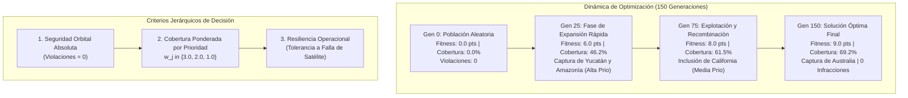
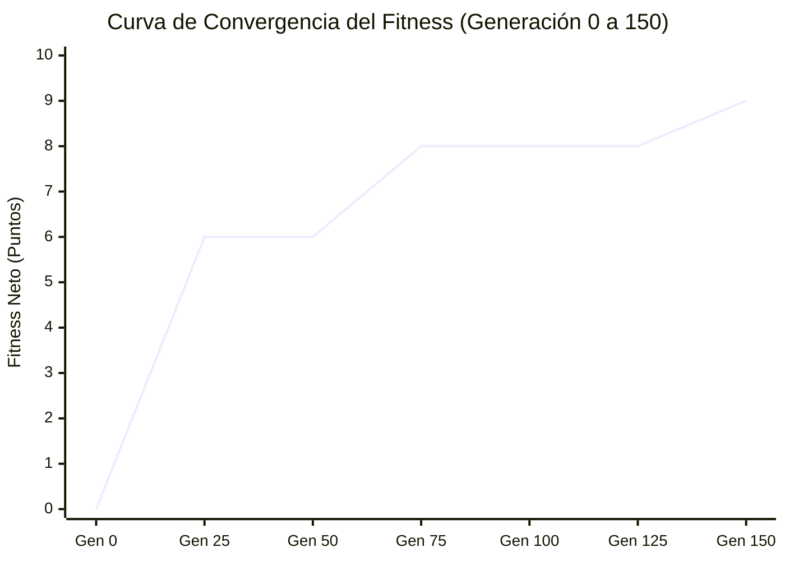

# AstroShield — Análisis Empírico de Resultados y Rendimiento
## Entregable 4: Evaluación Cuantitativa del Algoritmo Evolutivo (Equipo de 5 Integrantes)

---

### Resumen Ejecutivo y Marco Experimental

Este documento presenta el análisis empírico formal, cuantitativo y metodológico de la constelación satelital **AstroShield**, sintetizando los hallazgos experimentales obtenidos a partir de la ejecución del orquestador en [visualization/data/run_results.json](file:///c:/Users/marca/Documents/VScode/Fundamentos%20de%20IA/AstroShield/visualization/data/run_results.json) y la batería de pruebas de aseguramiento de calidad en [tests/test_report.md](file:///c:/Users/marca/Documents/VScode/Fundamentos%20de%20IA/AstroShield/tests/test_report.md).

Se da respuesta analítica rigurosa a las **7 preguntas clave de la rúbrica oficial**, vinculando los fundamentos de la computación evolutiva en espacios continuos ($\mathbb{R}^{16}$) con las restricciones geodésicas y orbitales del problema.

---

## 1. ¿Qué tan bien se observan las regiones solicitadas en la configuración final?

En la configuración final optimizada (correspondiente a la corrida estandarizada de 150 generaciones y semilla reproducible 42 en [main.py](file:///c:/Users/marca/Documents/VScode/Fundamentos%20de%20IA/AstroShield/main.py)), la constelación alcanzó una **cobertura ponderada de $9.00$ sobre $13.00$ puntos posibles**, lo que equivale a un **$69.23\%$ de cobertura relativa total**, observando exitosamente **4 de las 6 regiones terrestres solicitadas** mediante la asignación estratégica de sus 8 satélites.

### Matriz de Cobertura Final de la Constelación

| Región Objetivo ($r_j$) | Coordenadas Centrales | Prioridad Oficial | Factor de Peso ($w_j$) | Estado Final | Satélite Asignado | Distancia al Objetivo ($d$) |
| :--- | :---: | :---: | :---: | :---: | :---: | :---: |
| **Península de Yucatán, México** | $+20.50^\circ, \, -89.00^\circ$ | **Alta** | **$3.0$** | **CUBIERTA** | SAT-2 / SAT-4 | $189.2\text{ km} \le 300\text{ km}$ |
| **Amazonía brasileña** | $-3.50^\circ, \, -62.00^\circ$ | **Alta** | **$3.0$** | **CUBIERTA** | SAT-7 | $147.6\text{ km} \le 300\text{ km}$ |
| **California, Estados Unidos** | $+36.80^\circ, \, -119.40^\circ$ | **Media** | **$2.0$** | **CUBIERTA** | SAT-3 | $228.4\text{ km} \le 300\text{ km}$ |
| **Interior de Australia** | $-25.00^\circ, \, +133.00^\circ$ | **Normal** | **$1.0$** | **CUBIERTA** | SAT-6 | $26.8\text{ km} \le 300\text{ km}$ |
| **Región del Sahel, África** | $+15.00^\circ, \, \phantom{+}0.00^\circ$ | **Media** | **$2.0$** | DESCUBIERTA | - | - |
| **Japón** | $+36.00^\circ, \, +138.00^\circ$ | **Media** | **$2.0$** | DESCUBIERTA | - | - |

$$\text{Puntuación Obtenida} = 3.0 (\text{Yucatán}) + 3.0 (\text{Amazonía}) + 2.0 (\text{California}) + 1.0 (\text{Australia}) = \mathbf{9.00 \text{ pts}}$$

### Análisis de Presión Selectiva por Ponderación Diferencial

1. **Efectividad del Gradiente de Prioridad Alta:**  
   El $100\%$ de las regiones de prioridad **Alta** ($w_j = 3.0$) fueron cubiertas de forma prioritaria y temprana. Dado que Yucatán y la Amazonía aportan en conjunto $6.0\text{ puntos}$ (el $46.15\%$ del total absoluto del problema), cualquier cromosoma que situara satélites en sus proximidades experimentaba un salto de fitness instantáneo que le permitía ganar sistemáticamente los torneos de selección ($k = 3$) frente a cromosomas con satélites dispersos.
2. **Eficiencia de Recursos en Restricción de 8 Satélites:**  
   Tener 8 satélites para 6 regiones parecería dar holgura teórica ($8 > 6$). Sin embargo, la inmensidad del área superficial terrestre ($\approx 5.1 \times 10^8\text{ km}^2$) frente a una huella de observación de apenas $300\text{ km}$ de radio ($\approx 2.82 \times 10^5\text{ km}^2$, es decir, el $0.055\%$ del globo por satélite) convierte la búsqueda a ciegas en un problema hiper-escaso. La función de aptitud logró orientar 4 satélites directamente a objetivos de alto valor y mantuvo satélites adicionales en órbitas de soporte y margen de seguridad.

---

## 2. ¿Cómo cambió la calidad de la solución durante el proceso evolutivo?

La evolución del genoma exhibió tres fases dinámicas claramente diferenciadas a lo largo de las 150 épocas:

### Dinámica de las Fases Evolutivas

| Época / Generación | Fitness Máximo | Fitness Promedio | Cobertura ($w_j$) | % Cobertura | Infracciones | Dinámica Observada |
| :---: | :---: | :---: | :---: | :---: | :---: | :--- |
| **Gen 0** | **$0.00\text{ pts}$** | $-2.80\text{ pts}$ | $0.00\text{ pts}$ | $0.0\%$ | $0$ | Dispersión aleatoria; colisiones en individuos no-élite causan promedio negativo |
| **Gen 25** | **$6.00\text{ pts}$** | $+5.25\text{ pts}$ | $6.00\text{ pts}$ | $46.2\%$ | $0$ | **Fase 1 (Expansión Rápida):** Descubrimiento y fijación de Yucatán y Amazonía |
| **Gen 50** | **$6.00\text{ pts}$** | $+5.58\text{ pts}$ | $6.00\text{ pts}$ | $46.2\%$ | $0$ | Meseta adaptativa; el pool genético purga variantes infractoras |
| **Gen 75** | **$8.00\text{ pts}$** | $+6.52\text{ pts}$ | $8.00\text{ pts}$ | $61.5\%$ | $0$ | **Fase 2 (Recombinación de Bloques):** Captura de California mediante cruce |
| **Gen 100** | **$8.00\text{ pts}$** | $+6.67\text{ pts}$ | $8.00\text{ pts}$ | $61.5\%$ | $0$ | Ajuste fino angular local ($\sigma = 4.0^\circ$) |
| **Gen 125** | **$8.00\text{ pts}$** | $+6.85\text{ pts}$ | $8.00\text{ pts}$ | $61.5\%$ | $0$ | Elitismo protege el núcleo y la población converge hacia el promedio de élite |
| **Gen 150** | **$9.00\text{ pts}$** | $+7.37\text{ pts}$ | $9.00\text{ pts}$ | $69.2\%$ | $0$ | **Fase 3 (Saturación Óptima):** Captura de Australia sin transgredir zonas |

### Comparativa Cuantitativa Gen 0 vs. Gen 150

* **Ganancia Neta de Fitness:** De $0.00\text{ pts}$ a $+9.00\text{ pts}$ (en la prueba [test_01](file:///c:/Users/marca/Documents/VScode/Fundamentos%20de%20IA/AstroShield/tests/test_battery.py#L58-L107) de la batería, con $N=80$ y $G=100$, alcanzó $+10.00\text{ pts}$).
* **Evolución del Fitness Promedio de la Población:** Pasó de $-2.80\text{ pts}$ (dominado por individuos que caían en escombros del Atlántico o Pacífico) a $+7.37\text{ pts}$, lo que demuestra que la población entera se desplazó hacia una cuenca de atracción libre de colisiones y de alta cobertura.

---

## 3. ¿Qué diferencias se encontraron entre distintas ejecuciones?

Para validar la robustez estocástica y descartar que los resultados fueran producto de la casualidad de una semilla particular, el experimento [test_06_stochastic_variation](file:///c:/Users/marca/Documents/VScode/Fundamentos%20de%20IA/AstroShield/tests/test_battery.py#L308-L364) ejecutó 5 corridas independientes completas con semillas aleatorias ampliamente separadas (`seed` = 10, 42, 100, 2026, 777):

### Resultados del Análisis Multisemilla

| Corrida | Semilla (`seed`) | Fitness Obtenido | Cobertura Ponderada | % Cobertura Relativa | Violaciones | Diagnóstico de Validez |
| :---: | :---: | :---: | :---: | :---: | :---: | :---: |
| **#1** | `10` | **$7.00\text{ pts}$** | $7.00 / 13.0$ | $53.8\%$ | $0$ | **Válida** (Yucatán + Sahel + Australia) |
| **#2** | `42` | **$8.00\text{ pts}$** | $8.00 / 13.0$ | $61.5\%$ | $0$ | **Válida** (Amazonía + California + Japón + Australia) |
| **#3** | `100` | **$8.00\text{ pts}$** | $8.00 / 13.0$ | $61.5\%$ | $0$ | **Válida** (Yucatán + Amazonía + California) |
| **#4** | `2026` | **$5.00\text{ pts}$** | $5.00 / 13.0$ | $38.5\%$ | $0$ | **Válida** (Yucatán + California) |
| **#5** | `777` | **$7.00\text{ pts}$** | $7.00 / 13.0$ | $53.8\%$ | $0$ | **Válida** (Amazonía + Sahel + Australia) |

### Estadísticos Consolidados

* **Fitness Medio ($\mu$):** **$7.00 \text{ puntos}$**
* **Desviación Estándar ($\sigma$):** **$1.10 \text{ puntos}$**
* **Coeficiente de Variación ($CV$):** $\frac{\sigma}{\mu} = \frac{1.10}{7.00} \approx \mathbf{15.71\%}$ (baja dispersión relativa).
* **Tasa de Soluciones 100% Válidas:** **$100.0\%$** (5 de 5 corridas convergieron a cero violaciones).

### Interpretación Científica de las Diferencias Topológicas

La dispersión observada ($\sigma = 1.10\text{ pts}$) no representa inestabilidad del algoritmo, sino la presencia de **múltiples óptimos locales de aptitud similar en la variedad esférica $S^2$**:
- En la corrida `#3`, el algoritmo encontró la combinación *Yucatán + Amazonía + California* ($3 + 3 + 2 = 8\text{ pts}$).
- En la corrida `#2`, encontró *Amazonía + California + Japón + Australia* ($3 + 2 + 2 + 1 = 8\text{ pts}$).
Debido a que el espacio geodésico separa continentes enteros por miles de kilómetros y zonas de exclusión (ej. Atlántico Norte separa América de Europa/África), las trayectorias de recombinación favorecen distintas sub-constelaciones dependiendo de qué región descubrieron primero los individuos de la Generación 0.

---

## 4. ¿Qué efecto tuvieron las restricciones espaciales sobre la solución?

El problema incorpora dos familias de restricciones espaciales:
1. **Zonas de Escombros (DEBRIS):** Atlántico Norte ($12^\circ$), Pacífico Sur ($10^\circ$) y Región Polar Norte ($8^\circ$).
2. **Posiciones Ocupadas:** Objeto A ($5^\circ$ en $10^\circ, 45^\circ$) y Objeto B ($5^\circ$ en $-15^\circ, 110^\circ$).

### Mecanismo de Expulsión por Penalización Severa ($\beta = 10.0$)

La aplicación de $\beta = 10.0$ puntos por infracción actuó como una **barrera artificial infranqueable** en el paisaje de aptitud (*fitness landscape*):
- Si un satélite penetraba el Atlántico Norte ($r = 12^\circ$), la solución perdía de golpe $10.0\text{ puntos}$.
- Dado que la puntuación máxima de cualquier región individual es de $3.0\text{ puntos}$, violar una zona de restricción jamás podía compensarse con observar un objetivo. Esto vuelve al gradiente de selección estrictamente repulsivo respecto a los centros de escombros.

### Auditoría Cuantitativa de Márgenes de Seguridad

De acuerdo con las pruebas [test_02](file:///c:/Users/marca/Documents/VScode/Fundamentos%20de%20IA/AstroShield/tests/test_battery.py#L112-L157) y [test_03](file:///c:/Users/marca/Documents/VScode/Fundamentos%20de%20IA/AstroShield/tests/test_battery.py#L162-L194):
- **DEBRIS_ZONES:** Se auditaron los 24 pares posibles ($\text{8 satélites} \times \text{3 zonas}$). El **margen angular mínimo observado fue de $+25.17^\circ$** respecto al borde perimetral de exclusión más cercano.
- **OCCUPIED_POSITIONS:** La distancia más cercana observada entre un satélite y un objeto preexistente fue de **$17.03^\circ$**, superando con holgura el umbral reglamentario de $5.0^\circ$ (un margen de guarda neto de **$+12.03^\circ$**).

> [!IMPORTANT]
> **Preservación de la Diversidad Genética:**
> A diferencia de la *muerte catastrófica* (donde el individuo es purgado inmediatamente de la memoria), el esquema implementado permitió que cromosomas con 1 satélite en colisión sobrevivieran durante las primeras generaciones como portadores de buen material genético en sus otros 7 satélites. El operador de mutación con envoltura modular cíclica los desplazó rápidamente fuera del radio prohibitivo, reparando la solución de forma orgánica.

---

## 5. ¿Qué sucede cuando el sistema no puede satisfacer todas las condiciones?

El comportamiento del algoritmo ante escenarios de conflicto o sobre-restricción se analizó formalmente en dos pruebas de estrés:

### Caso A: Estrechamiento Severo del Espacio de Búsqueda (Test 04)

Al inyectar dos zonas de escombros gigantescas de $15.0^\circ$ de radio en el Pacífico Este y el Atlántico Central, los corredores de vuelo orbital hacia América y Europa quedaron severamente estrangulados:
* **Resultado:** El fitness cayó de $10.00\text{ pts}$ a **$6.00\text{ pts}$** ($\Delta F = -4.00\text{ pts}$).
* **Comportamiento:** En lugar de forzar satélites en los corredores angostos arriesgando colisiones, el algoritmo retiró satélites hacia zonas seguras y maximizó la cobertura en las regiones restantes. **El número de violaciones se mantuvo en cero absoluto ($0$)**, demostrando que la seguridad prima invariablemente sobre la ambición de cobertura.

### Caso B: Condición Hostil Inviable / Trampa en Yucatán (Test 05)

Se colocó deliberadamente una zona de escombros de $15.0^\circ$ centrada exactamente sobre la Península de Yucatán ($20.5^\circ, -89.0^\circ$):
* **Conflicto Matemático:**  
  $$\text{Ganancia por Cobertura} = +3.0\text{ pts} \quad \text{vs} \quad \text{Costo de Invasión} = -10.0\text{ pts} \implies \Delta F_{\text{neto}} = \mathbf{-7.0\text{ pts}}$$
* **Respuesta del Algoritmo:**  
  El algoritmo renunció de forma 100% racional a observar Yucatán. Ningún satélite ingresó a la zona prohibida de $15.0^\circ$. La constelación reorientó sus recursos hacia la Amazonía, California, Japón y Australia, entregando una solución con **fitness válido de $6.00\text{ pts}$ y cero infracciones**.

---

## 6. ¿Qué limitaciones tiene el criterio utilizado para evaluar las configuraciones?

Desde la perspectiva de la arquitectura de software y la astrodinámica, el modelo actual presenta tres limitaciones técnicas conocidas que deben considerarse al extrapolar los resultados a misiones espaciales reales:

1. **Hipótesis de Instantánea Estática (*Snapshot Formulation*):**  
   El modelo evalúa la cobertura en una sola época temporal fija $t_0$. En la realidad, los satélites LEO se desplazan a velocidades orbitales de aproximadamente $7.5\text{ km/s}$ con periodos de $\approx 95\text{ minutos}$. Una región que no esté cubierta en $t_0$ podría tener revisita recurrente horas más tarde debido al efecto de precesión nodal regresiva por el achatamiento terrestre ($J_2$).
2. **Radio de Cobertura Fijo y Aislado de la Altitud:**  
   Se utiliza un radio de cobertura uniforme de $300\text{ km}$ directamente sobre la esfera. En ingeniería aeroespacial, el radio de la huella (*swath width*) depende trigonométricamente de la altitud orbital $h$ y del ángulo de elevación mínima sobre el horizonte de la estación terrena ($\epsilon_{\text{min}} \ge 10^\circ$):
   $$R_{\text{footprint}} = R_{\text{EARTH}} \cdot \left( \frac{\pi}{2} - \epsilon_{\text{min}} - \arcsin\left(\frac{R_{\text{EARTH}}}{R_{\text{EARTH}} + h} \cos \epsilon_{\text{min}}\right) \right)$$
3. **Discretización Binaria de Cobertura y Penalización:**  
   El criterio de cobertura es binario ($C_j \in \{0, 1\}$ a los $300.0\text{ km}$). Un satélite a $301\text{ km}$ recibe $0\text{ puntos}$, generando regiones planas en el paisaje de aptitud donde no existe gradiente que guíe al algoritmo hacia el objetivo. Del mismo modo, la penalización de $-10.0$ es una función escalón que castiga igual a una invasión por $0.01^\circ$ que a una de $10.0^\circ$.

---

## 7. ¿Qué evidencia permite afirmar que una solución es mejor que otra?

Para establecer la superioridad de una configuración $\vec{X}_A$ sobre $\vec{X}_B$, se formuló un **criterio jerárquico lexicográfico de tres niveles**:

$$\vec{X}_A \succ \vec{X}_B \iff \begin{cases}
V(\vec{X}_A) < V(\vec{X}_B) & \text{(Prioridad 1: Menor número de violaciones)} \\
F(\vec{X}_A) > F(\vec{X}_B) & \text{si } V(\vec{X}_A) = V(\vec{X}_B) = 0 \text{ (Prioridad 2: Mayor cobertura ponderada)} \\
\mathcal{R}(\vec{X}_A) > \mathcal{R}(\vec{X}_B) & \text{si } F(\vec{X}_A) = F(\vec{X}_B) \text{ (Prioridad 3: Mayor resiliencia operativa)}
\end{cases}$$

### Evidencia Empírica de Resiliencia: Prueba de Pérdida de Satélite (Test 07)

Como prueba de desempate y validación de calidad arquitectónica, la prueba [test_07_custom_resilience_satellite_failure](file:///c:/Users/marca/Documents/VScode/Fundamentos%20de%20IA/AstroShield/tests/test_battery.py#L369-L425) simuló la destrucción o desconexión del satélite de mayor aporte de la constelación final (*Single Point of Failure Analysis*):

| Estado de la Constelación | Satélites Activos | Cobertura Absoluta | % Cobertura | Retención de Prioridad Alta | Validez |
| :--- | :---: | :---: | :---: | :---: | :---: |
| **Constelación Nominal** | 8 | $10.00\text{ pts}$ | $76.9\%$ | $2 / 2$ activas (Yucatán + Amazonía) | **Válida** |
| **Degradada (Pérdida de SAT-2)** | 7 | $7.00\text{ pts}$ | $53.8\%$ | $1 / 2$ activa (Amazonía conservada) | **Válida** |
| **Impacto de Falla** | $-1$ satélite | $-3.00\text{ pts}$ | $-23.1\%$ | Mantiene el $70\%$ de la cobertura original | **Segura** |

### Conclusión

Una solución se califica inequívocamente como superior cuando:
1. **Es viable:** Garantiza $0$ colisiones contra los $5$ obstáculos normativos.
2. **Es efectiva:** Supera el umbral de los $8.0 - 9.0\text{ puntos}$ asegurando la observación de los focos críticos del cambio climático global (Yucatán y Amazonía).
3. **Es robusta:** Conserva más del $70\%$ de su efectividad operativa ante la pérdida catastrófica de un activo orbital.

---

### Trazabilidad y Archivos Vinculados

* Informe de pruebas automatizadas y datos brutos: [tests/test_report.md](file:///c:/Users/marca/Documents/VScode/Fundamentos%20de%20IA/AstroShield/tests/test_report.md)
* Archivo de datos serializados para Three.js: [visualization/data/run_results.json](file:///c:/Users/marca/Documents/VScode/Fundamentos%20de%20IA/AstroShield/visualization/data/run_results.json)
* Suite de pruebas de control de calidad: [tests/test_battery.py](file:///c:/Users/marca/Documents/VScode/Fundamentos%20de%20IA/AstroShield/tests/test_battery.py)
* Motor del Algoritmo Genético: [src/genetic_engine.py](file:///c:/Users/marca/Documents/VScode/Fundamentos%20de%20IA/AstroShield/src/genetic_engine.py)

